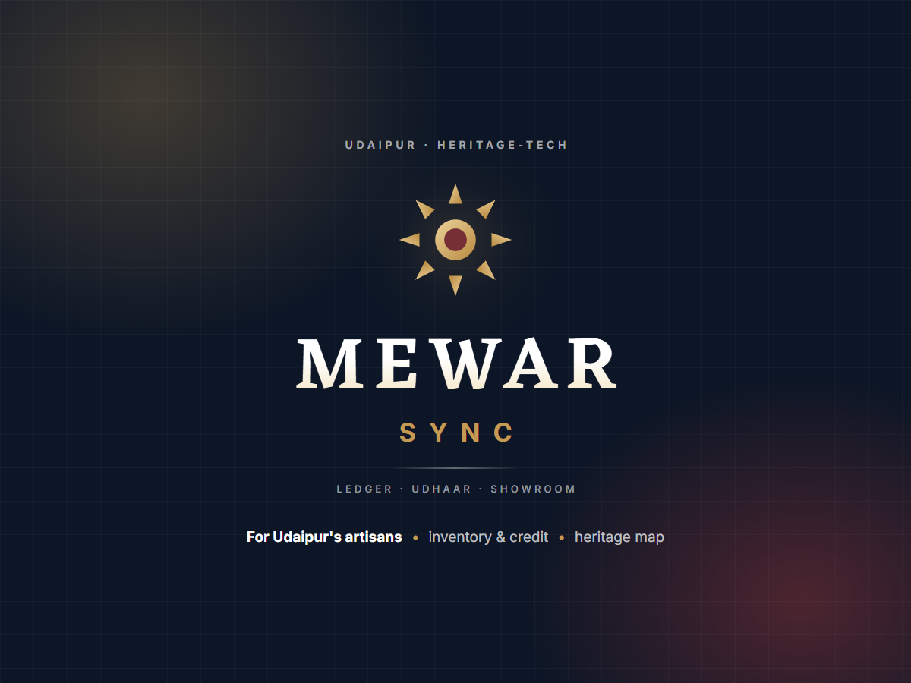
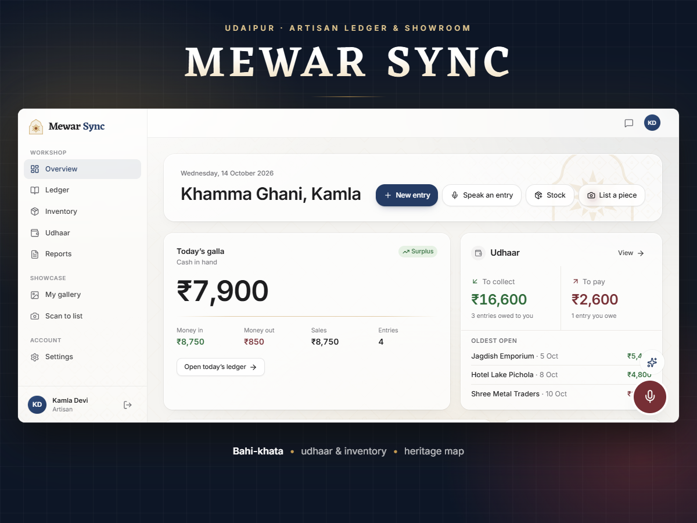
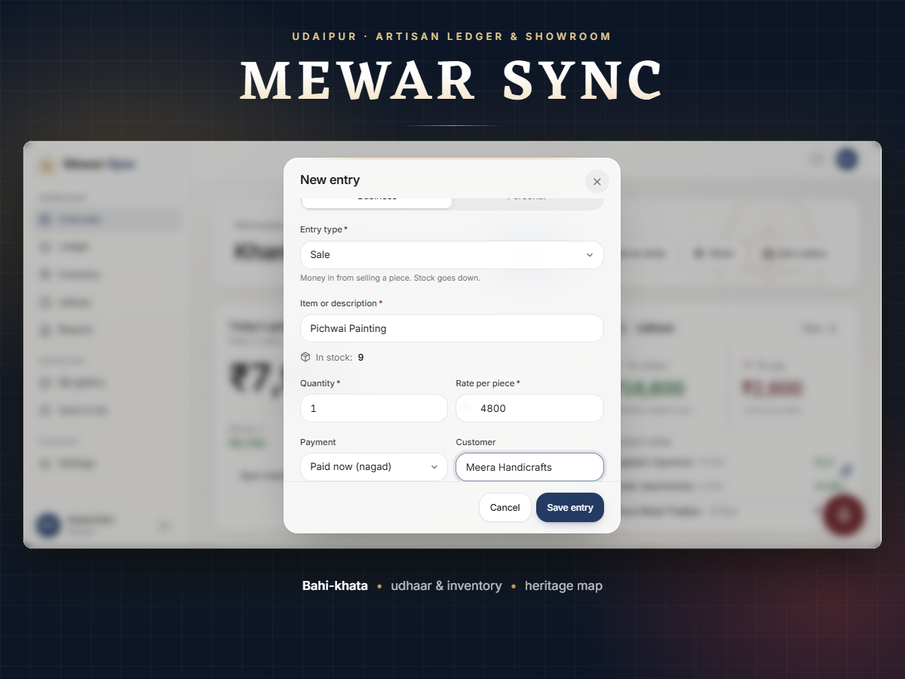
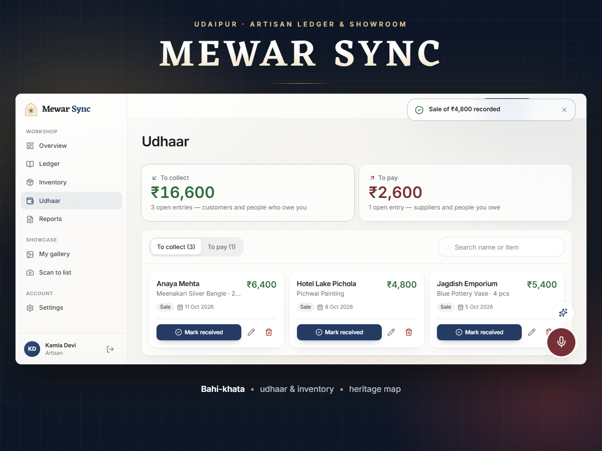
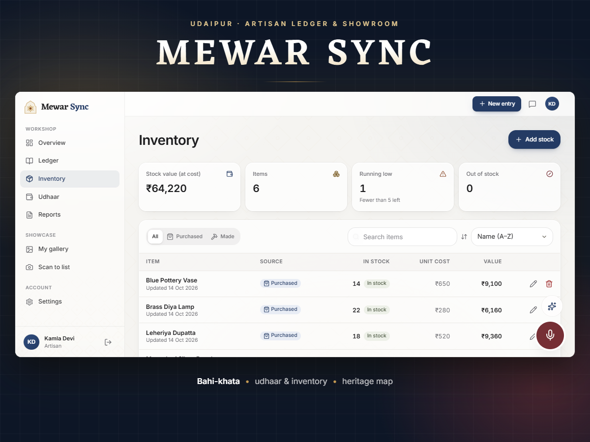
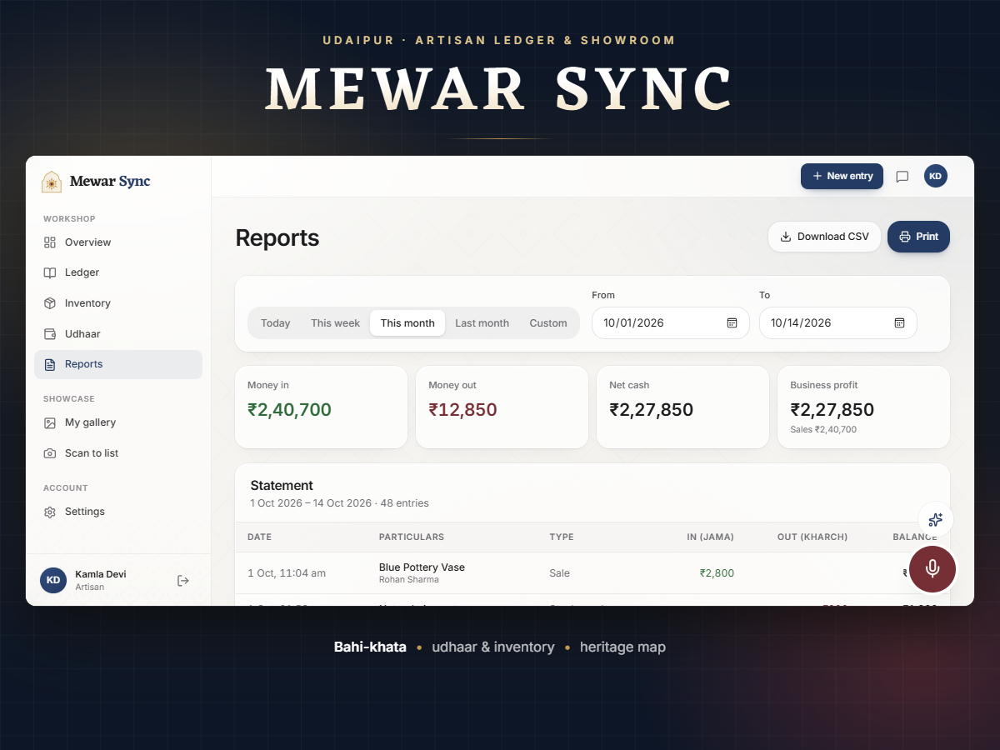
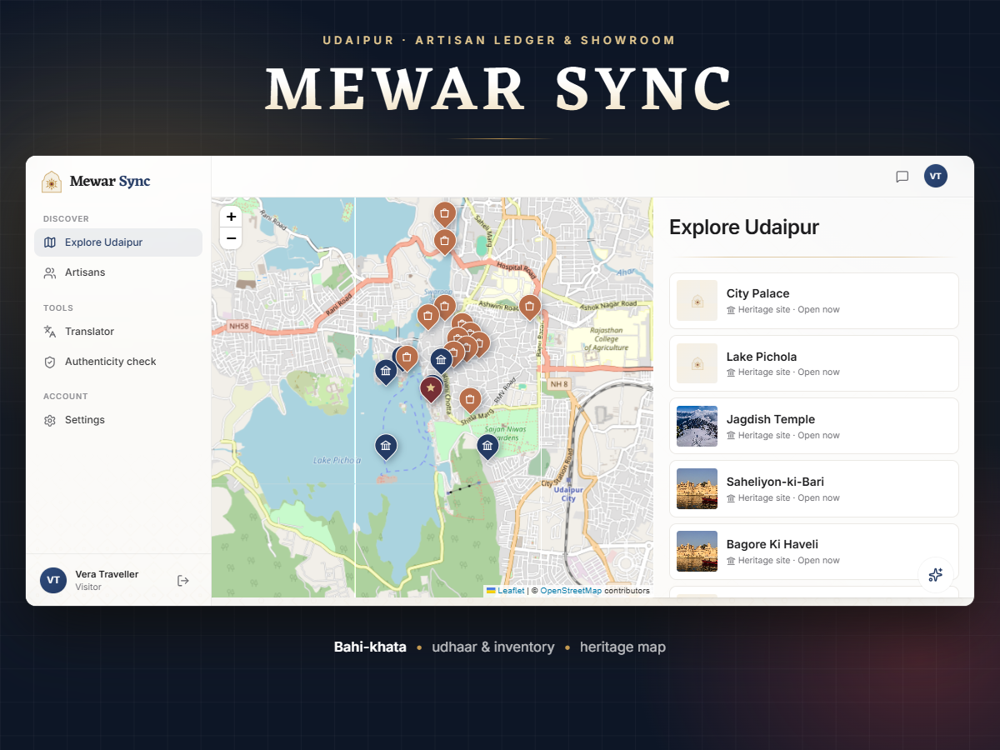
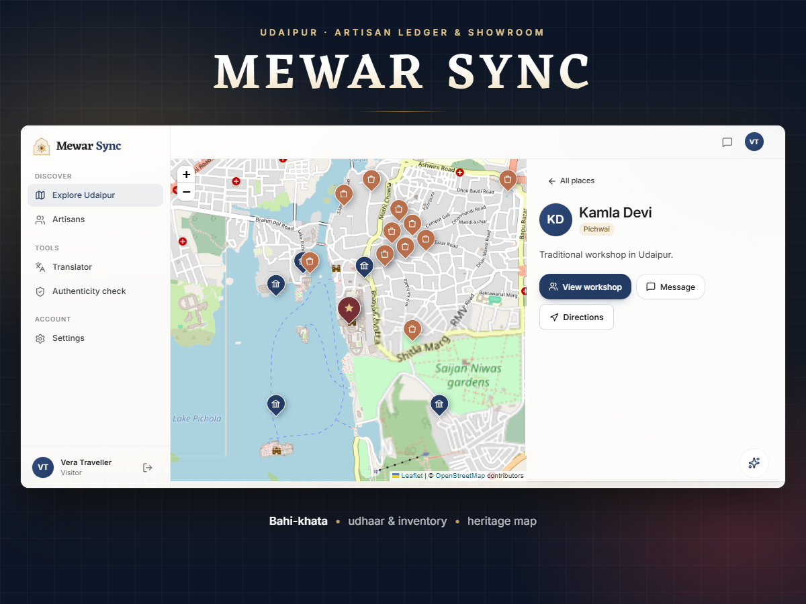
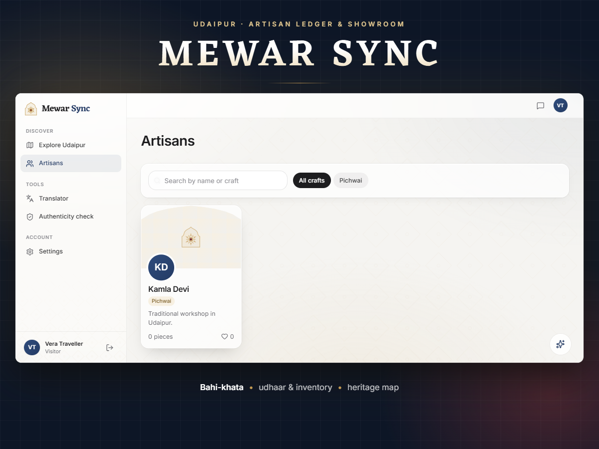

<p align="center">
  
</p>

<h1 align="center">Mewar Sync</h1>

<p align="center">
  <b>A digital bahi-khata, stockroom and showroom for the artisans of Udaipur.</b><br/>
  Ledger · Udhaar (credit) · Inventory · Heritage map · Artisan directory
</p>

<p align="center">
  <a href="MewarSync-Demo/video/MewarSync-preview.mp4">▶ Watch the preview video</a>
</p>

---

## What it is

Udaipur's painters, carvers and craftspeople still keep accounts the traditional way — a cloth-bound **bahi-khata** (ledger), a mental list of who owes what (**udhaar**), and stock counted by eye. Visitors, meanwhile, struggle to find genuine workshops among the tourist shops.

**Mewar Sync** connects both sides:

- **For artisans** — a simple business workspace: record sales and expenses, track credit, keep stock in step with sales, print statements, and publish their crafts to a public gallery.
- **For visitors** — a heritage map of Udaipur's palaces, lakes and bazaars with the workshops of real artisans pinned on it, artisan profiles, direct messaging, a translator and an AI authenticity check.

The interface is deliberately calm and modern — a light, Apple-style design with a quiet Udaipur identity: a sun-in-jharokha emblem, fine antique-gold lines and a barely-visible jaali (lattice) texture.

---

## A tour of the system

### Artisan overview
The day at a glance: **today's galla** (cash in hand from paid entries), money still to collect and to pay, stock that is running low, a cash-flow chart and recent activity.



### Recording an entry
Every sale, stock purchase, expense or personal payment goes through one form. Totals are calculated as you type, stock levels are shown for the item being sold, and entries can be marked **paid now** or **udhaar — pay later**.



### Udhaar (credit)
Credit is split into what customers owe the artisan and what the artisan owes suppliers. Marking an entry as settled moves it into today's ledger as cash — exactly once, even if the button is pressed twice.



### Inventory
Stock value at cost, items running low or out of stock, and purchased versus self-made pieces. Sales automatically draw down stock; stock purchases add to it.



### Reports
Pick a period (today, this week, this month, custom) to see money in and out, profit, and a running-balance statement that can be printed or downloaded as CSV.



### Visitor heritage map
Heritage sites, markets and artisan workshops on one map, with ticket prices, a visit-cost planner, an audio guide and AI-suggested activities.



### Finding an artisan's workshop
Tapping a workshop pin shows the artisan, with directions, their full profile and a way to message them.



### Artisan directory
Browse artisans by craft, open their gallery of pieces, like their work and start a conversation.



---

## Who uses it

| Role | What they can do |
| --- | --- |
| **Artisan** | Overview, ledger (business & personal), inventory, udhaar, reports, gallery, *Scan to list*, messages, settings |
| **Visitor** | Explore map, artisan directory and profiles, messaging, translator, authenticity check, settings |
| **Administrator** | Curate photos for heritage sites and markets |

Roles are fixed when an account is created. Nobody can promote themselves to administrator from the app.

---

## Key features

**Bahi-khata ledger**
- Sales, stock purchases, other expenses, and personal money given or received.
- Amounts are validated to the paisa; negative, zero or impossible values are rejected rather than silently "fixed".
- Editing or deleting a sale puts stock back automatically, so the ledger and stockroom never drift apart.

**Udhaar tracking**
- Receivables and payables are kept separate.
- Settling credit moves it into the cash ledger on the day it is paid.

**Inventory**
- Low-stock and out-of-stock flags, valuation at cost, purchased vs. made in workshop.
- Overselling is impossible: two sales racing for the last item cannot both succeed.
- Duplicate items can be merged in one step.

**Scan to list**
- Photograph a piece; an AI curator drafts a title, story and suggested price.
- The artisan reviews and edits everything before it is published.

**Voice entry** *(built, currently hidden)*
- Speak an entry in Hindi, Mewari or English — "2 pichwai bechi 6000 mein".
- The spoken words become an editable draft; nothing is saved until the artisan confirms.

**For visitors**
- Interactive Udaipur map with entry fees, timings, Mewari phrases and a trip-cost estimator.
- Direct chat with artisans, with read receipts.
- Translator between English, Hindi, Marwari and Mewari.
- AI authenticity check — an opinion on whether a piece looks hand-painted, clearly labelled as not a certificate.

**Help assistant** — an in-app AI guide that explains how to use the system.

**Languages** — navigation is available in English, Hindi and Marwari.

---

## How the system works

```
┌──────────────────────────┐        ┌───────────────────────────────┐
│  Web app (React + Vite)  │──────▶ │  Firebase Authentication      │
│  · artisan workspace     │        │  Cloud Firestore (data)       │
│  · visitor explorer      │◀────── │  protected by security rules  │
└────────────┬─────────────┘        └───────────────────────────────┘
             │ signed-in requests
             ▼
┌──────────────────────────┐        ┌───────────────────────────────┐
│  Mewar Sync API (Node)   │──────▶ │  Google Gemini (AI)           │
│  · verifies sign-in      │        └───────────────────────────────┘
│  · checks role & limits  │
│  · validates AI answers  │        Cloudinary — image hosting
└──────────────────────────┘        OpenStreetMap — maps & search
```

- **Web app** — React 19 single-page app with a shared design system (tokens, glass surfaces, accessible dialogs and forms).
- **Data** — Firebase Authentication for accounts and Cloud Firestore for records. Every ledger, stock and credit record belongs to one artisan, and the database itself refuses any other account's reads or writes.
- **Transactions** — a sale and its stock change are written together or not at all. Each entry carries a one-time ID, so retries and double taps cannot create duplicates.
- **API server** — the only place the AI key lives. It confirms who is calling, checks their role (e.g. only artisans can parse ledger entries), limits request rates, and validates everything the AI returns before it reaches the app.
- **AI is advisory only** — every AI output (voice drafts, product descriptions, prices, authenticity opinions) is shown to a person to review. It never writes to the books on its own.

---

## Security & data integrity

- Each artisan's ledger, stock, credit and messages are private to them; conversations are private to their two participants.
- Roles cannot be self-assigned. Products cannot mark themselves "verified" — only an administrator can.
- Every write is checked for allowed fields, types and ranges, both in the app and in the database rules.
- Signed-in identity is verified on the server; the AI key never reaches the browser.
- Printed reports and CSV exports are protected against injected code and spreadsheet formulas.
- Strict security headers (Content Security Policy, clickjacking protection) are applied in production.

The full audit — findings, fixes and remaining risks — is in [`docs/AUDIT_REPORT.md`](docs/AUDIT_REPORT.md).

---

## Quality

The system is covered by automated tests at every layer:

| Layer | What is tested |
| --- | --- |
| Business logic | Money, ledger totals, udhaar, stock matching, voice-draft safety |
| API server | Sign-in checks, roles, input limits, rate limits, safe errors, security headers |
| Database rules | Tenant isolation, privilege escalation, field tampering, chat privacy |
| Data layer | Atomic sales, oversell races, edit/delete stock reconciliation, settlement |
| End-to-end | Real browser flows for artisans and visitors, plus layout checks from 360 px phones to 1920 px desktops |

---

## Project structure

```
App.tsx                  app shell, routing and sign-in states
components/ui            design system — buttons, forms, dialogs, cards, toasts
components/layout        sidebar, toolbar, error handling
components/Artisan       overview, ledger, inventory, udhaar, reports, gallery, scan to list, settings
components/Visitor       heritage map, artisan directory, profiles, product view
components/…             messenger, help assistant, translator, authenticity check, voice
lib/                     business rules — money, ledger, inventory, voice, dates
services/                Firebase, data access, API client
server/                  API server — sign-in checks, roles, AI integration, security headers
firestore.rules          database access rules
tests/                   unit, API, rules, integration and end-to-end tests
MewarSync-Demo/          screenshots and preview video
```

---

<p align="center"><i>Khamma Ghani — made for the artisans of Mewar.</i></p>
